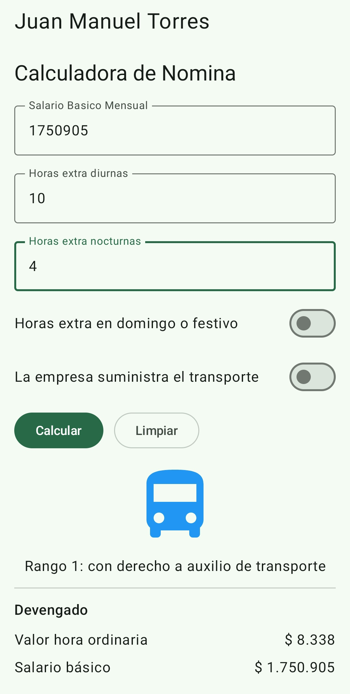
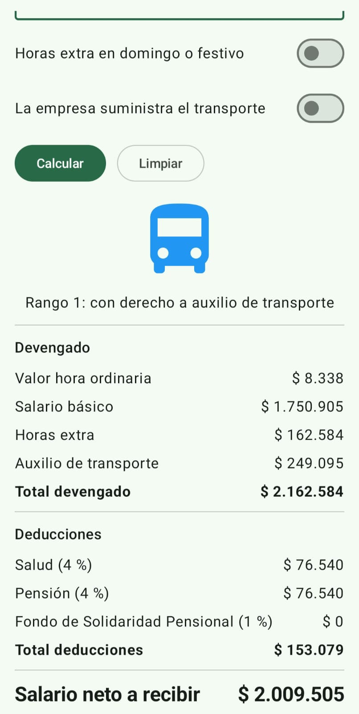
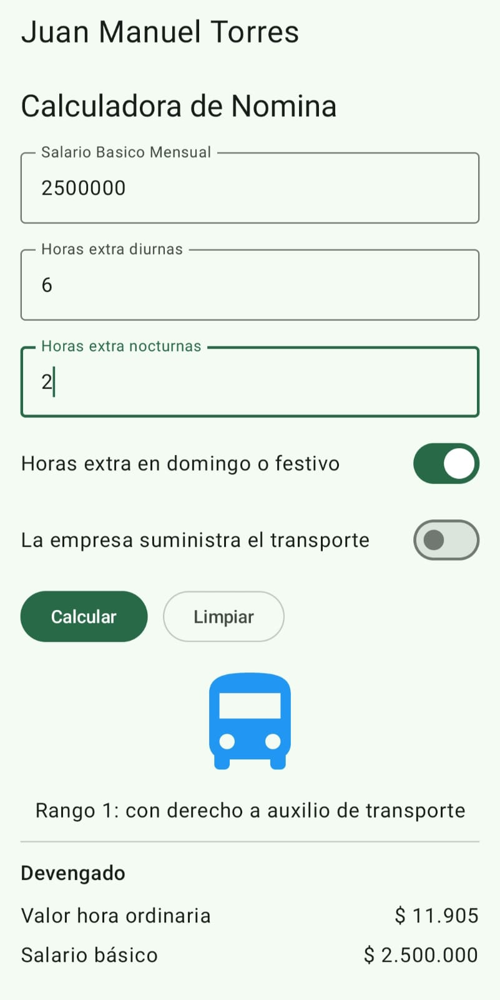
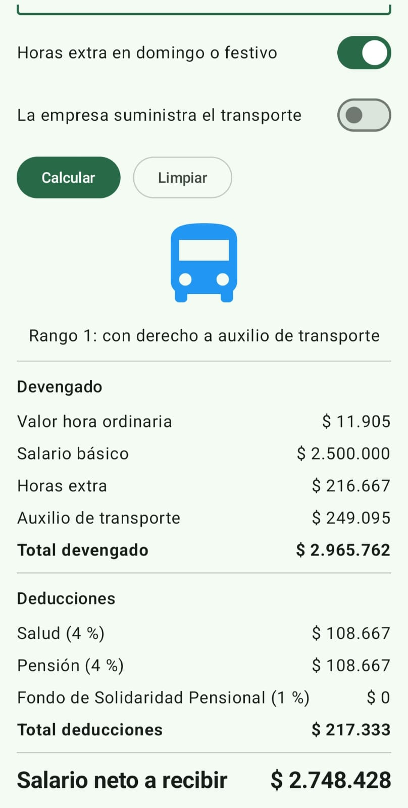
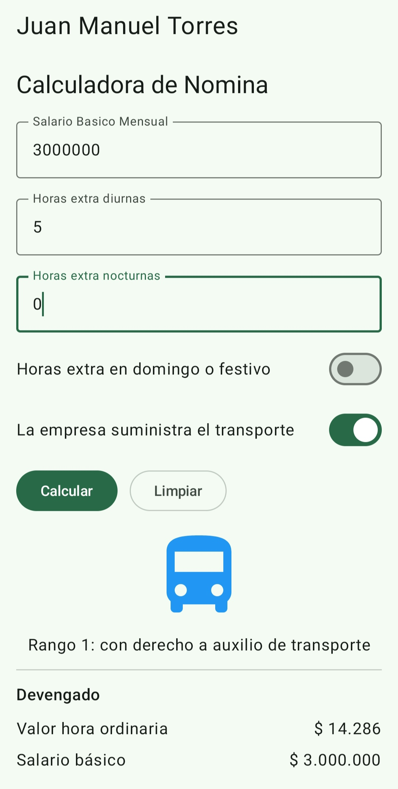
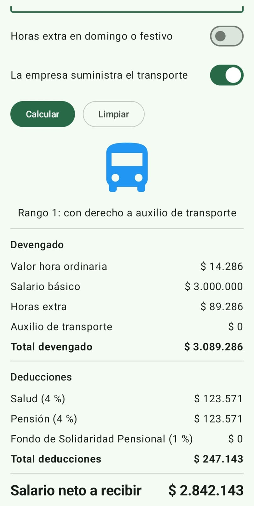
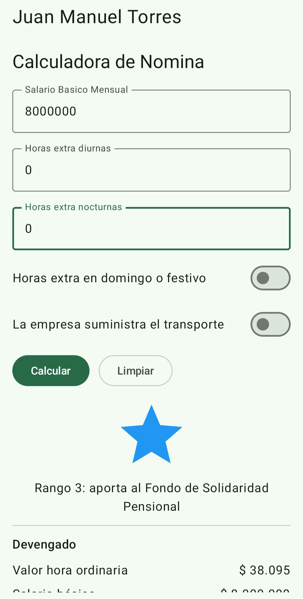
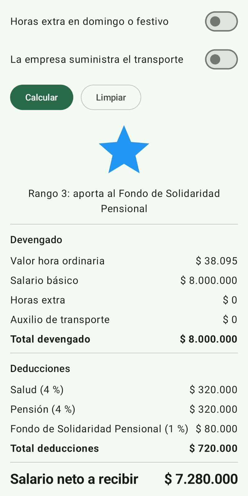
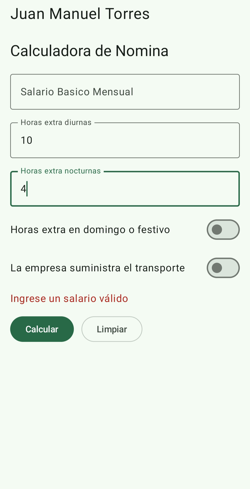

# Calculadora de Nómina Colombiana

**Estudiante:** Juan Manuel Torres Villota
**Código:** 54836

## Descripción

Aplicación Android desarrollada con Jetpack Compose que permite a un
trabajador colombiano estimar su pago mensual. A partir del salario
básico y las horas extra, calcula el valor de las horas extra, el
auxilio de transporte, las deducciones de ley y el salario neto, con
un desglose de cada concepto.

Es un modelo simplificado con fines académicos.

## Capturas de pantalla

### Caso A: salario mínimo con horas extra en día hábil

### Caso B: horas extra en domingo o festivo

### Caso C: transporte suministrado por la empresa

### Caso D: salario alto con Fondo de Solidaridad

### Caso E: mensaje de validación
